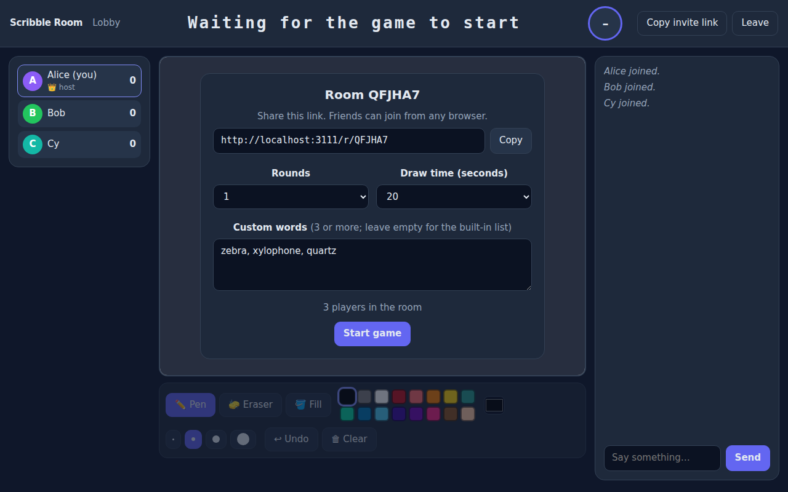
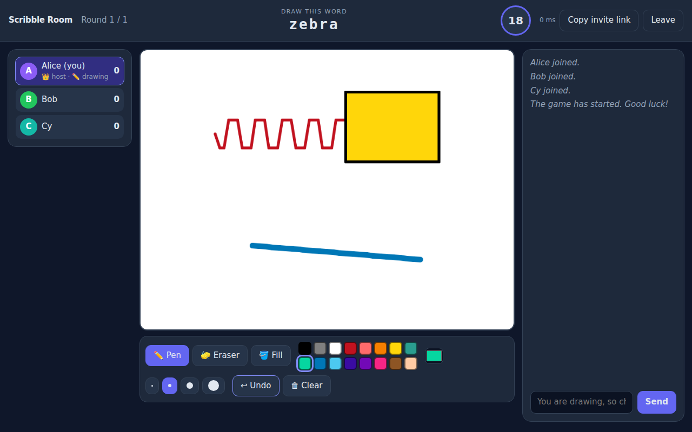

# Scribble Room

A real-time multiplayer drawing and guessing game for the browser, in the style of Skribbl.io. One player gets a secret word and draws it, everyone else guesses in chat, and faster correct guesses earn more points. The server runs the whole game: a modified client cannot see the word or give itself points.

## Run it

Requires Node.js 20 or newer.

```bash
npm install && npm start
```

Then open <http://localhost:4100>, create a room, and open the invite link in two or more other tabs or browsers. Each tab is its own player, and refreshing a tab gets the same seat back. To play from other devices on your network, open `http://<your-ip>:4100` (the server listens on all interfaces).

| Command | What it does |
|---|---|
| `npm start` | Starts the server on port 4100 (set `PORT` to change it) |
| `npm test` | Runs the 19 automated server tests (about 90 seconds) |
| `npm run loadtest` | Measures how many rooms one process can handle (see `NOTE.md`) |
| `python test/browser_check.py` | Plays a full game in three real Chromium browsers (see the file header) |

## How to play

1. Enter a name and create a room. Set the rounds, the draw time and, if you like, your own word list.
2. Share the room link. Players join from it.
3. The host starts the game. Each player draws once per round: the drawer picks one of 3 words, a countdown starts, and letters of the word are revealed as time passes.
4. Everyone else guesses in chat. The faster the correct guess, the more points (500 at the start of the turn, falling to 100 at the end). The drawer earns the average of the guessers' points.
5. At the end there is a leaderboard and a stroke-by-stroke replay of every drawing.




## Requirements checklist

| Requirement | How it is done | Checked by |
|---|---|---|
| Rooms via shareable link; host sets rounds, draw time, word list | `/r/CODE` links; settings validated and clamped server-side | tests 13, 18; browser check |
| Pen, colours, brush size, eraser, fill, undo, clear | Canvas actions form a stack; undo pops it and everyone re-renders from the stack | browser check (pixel-identical canvases) |
| Strokes stream with no visible lag | Points batched once per animation frame, relayed immediately, no compression, `TCP_NODELAY` | load test latency |
| Drawer picks from 3 words, countdown, letter hints, round ends on time or when everyone guessed | Server state machine (`server/room.js`) with server-side timers. The turn also ends when the last player still guessing leaves, but not when someone merely refreshes | tests 8, 9, 10, 14, 15 |
| Server is the authority | The secret word is only ever put in messages for the drawer, players who already guessed, or after the turn; guesses, clock and points exist only on the server | tests 1, 2, 3 |
| Correct guessers cannot reveal the word; near misses show "close!" | Guessers who got it talk on a private channel and cannot type the word; "close!" goes only to the person who guessed | tests 4, 5 |
| Mid-round joiners see the canvas; refresh or drop up to 30 s keeps the score | Full canvas snapshot on join; secret token per player; 30 s grace period | tests 6, 7 |
| Drawer leaves mid-turn: game recovers | The turn ends immediately on an explicit leave, or after an 8 s grace if the connection drops; the next drawer is chosen. A host who drops hands the host role to the next player | tests 8, 9, 16 |
| Rate limiting, message and stroke size limits | Token buckets per connection and message type; size, range and count limits on every field. If the server refuses a drawer's operation, it sends the drawer its canvas back so the drawer never drifts from what others see | tests 11, 17 |
| Stroke-by-stroke replay | Every operation is logged with a timestamp and replayed in the browser | test 12; browser check |

## How it works

- **Server** (`server/`): plain Node HTTP server plus the `ws` WebSocket library. `room.js` holds the game state machine; `index.js` handles connections, limits and persistence.
- **Client** (`public/`): no build step. `canvas.js` is the drawing model shared by live play, late joiners, undo and the replay; `app.js` is the UI.
- **Protocol:** JSON messages over one WebSocket. The client sends `create`, `join`, `chat`, `pick`, `start`, `settings`, drawing operations (`ds`, `dp`, `de`, `fill`, `undo`, `clear`) and a few others. The server sends `state` (the full view for that player), `op` (a numbered drawing operation), `players`, `hint`, `chat`, `secret` and a few others. See `NOTE.md` for the details that matter for sync, restarts and capacity.

## Configuration

Everything is set by environment variables (defaults in `server/config.js`), for example `PORT`, `GRACE_MS` (reconnect window, 30000), `PERSIST=0` to turn off saving state to disk, and the limit values.

## Project layout

```
server/   index.js (HTTP, WebSocket, limits, persistence)   room.js (game logic)   util.js  words.js  config.js  stats.js
public/   index.html  style.css  app.js  canvas.js  net.js  replay.js
test/     game.test.js (19 server tests)   helpers.js   browser_check.py
loadtest/ loadtest.js   results-linux.json   results-windows.json
```

## Limitations (honest list)

- One server process. Rooms live in that process's memory, with a snapshot on disk for restarts. Running several instances would need shared state and routing of each room to one instance.
- Tested in Chromium on Windows and Linux. Touch input and phones have not been tested.
- On Windows, stop the server with Ctrl+C (or Ctrl+Break) so it writes its final snapshot. `taskkill /F` is a hard crash: rooms still come back from the snapshot taken every 2 seconds.
- All measurements were taken over localhost, so they do not include real internet latency.
- Capacity is bounded by socket writes, not game logic: about 500 rooms per process on Linux and about 200 on a Windows laptop with every drawer drawing non-stop (details in `NOTE.md`).
- Flood fill is computed on each client from the same operations, so tiny anti-aliasing differences between browsers could produce slightly different fill edges.
- The replay keeps at most 6,000 operations per drawing.

## Built with AI assistance

This project was built with the help of an AI assistant (Claude), which the assignment allows. I reviewed the code and I can explain every part of it.
