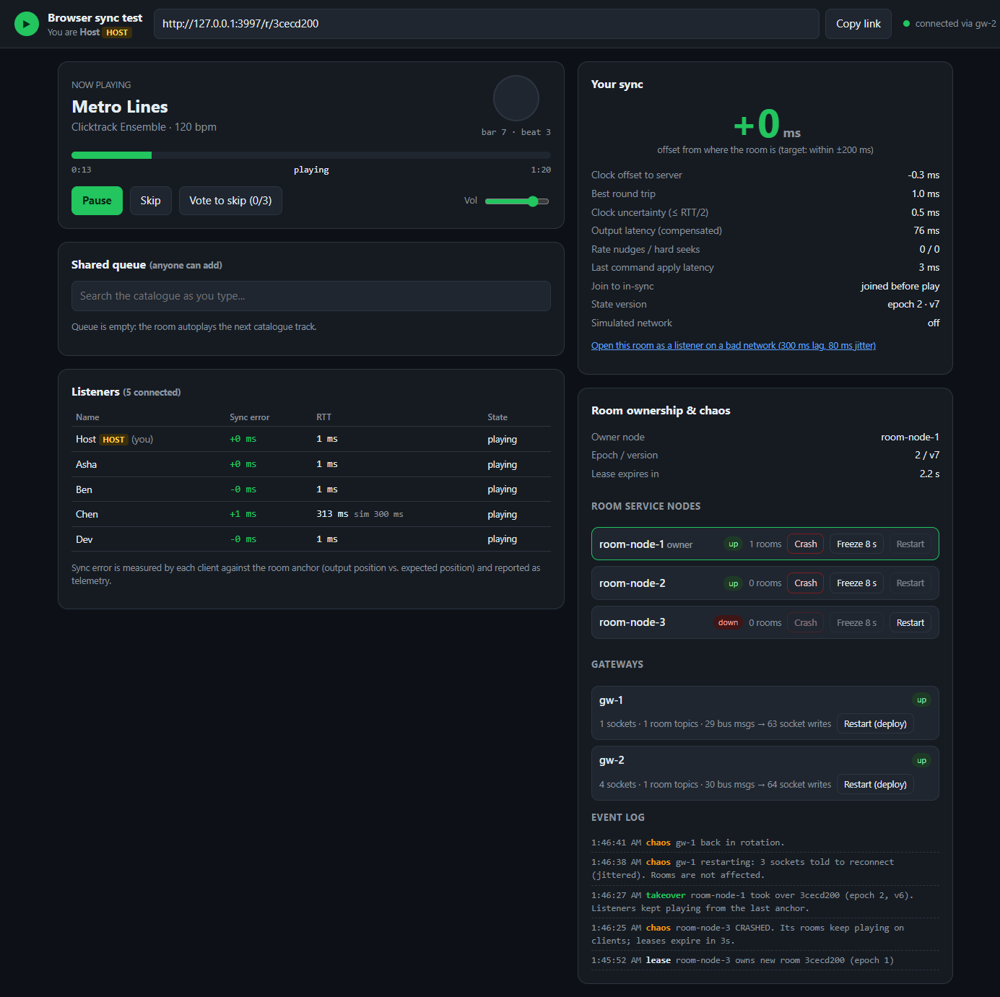

# Q2: Music streaming with "Listen Together" rooms

Architecture for a Spotify-style streaming service with shared listening rooms, plus a **working proof of concept** of the hardest part: keeping every listener in a room within ~200 ms. It covers clock sync, state anchors, drift correction, a single-writer room owner with lease and fencing failover, and gateway fan-out.

## Deliverables

| Deliverable | File |
|---|---|
| Design doc (6 pages): decisions and rejected alternatives, 11 failure scenarios, build-first plan for a team of three | [docs/Q2_Design_Doc.pdf](docs/Q2_Design_Doc.pdf) (source: [docs/DESIGN.md](docs/DESIGN.md)) |
| Architecture diagram | [docs/architecture_diagram.pdf](docs/architecture_diagram.pdf) / [png](docs/architecture_diagram.png) |
| Sequence diagram: host presses pause in a room of 5,000 listeners | [docs/sequence_pause_5000.pdf](docs/sequence_pause_5000.pdf) / [png](docs/sequence_pause_5000.png) |
| Proof of concept (runnable) | [poc/](poc/) |
| Measured results | [poc/bench/results-*.json](poc/bench/) |
| Sync simulation (5,000 listeners, realistic RTTs) | [sim/q2_sync_poc.py](sim/q2_sync_poc.py) |


## Run the proof of concept (one command)

Requires Node.js 20 or newer.

```bash
cd poc
npm install
npm start          # http://localhost:3000
```

This starts one core process (3 Room Service nodes, the lease store, the state store and the bus) plus 2 gateway processes sharing port 3000. The audio is generated on first start: synthesized click tracks over chords, so the repo ships no copyrighted music, and you can *hear* when two devices are out of sync.

### A 2-minute demo

1. Open http://localhost:3000, enter a name and create a room.
2. Click **Copy link** and open it in two more browsers (for example Chrome, Edge and an incognito window). Join with different names.
3. As host, press **Play**. The beat circles flash together, and the clicks line up across speakers. Each listener's **sync error** shows in the Listeners table.
4. Click the progress bar to **seek** for everyone. Press **Pause**: everyone stops at the identical position.
5. Open the **bad network** link (300 ms lag, 80 ms jitter, messages can arrive out of order). That listener stays in sync.
6. Add tracks to the **shared queue** (search as you type). **Vote to skip** from two listeners and the track skips at 50%.
7. Chaos panel:
   - **Crash** the owner node. Audio keeps playing; after the 5 s lease a new node takes over with epoch +1 (see the event log).
   - **Freeze** the owner for 8 s to simulate a GC or VM stall, and press **Pause** while it is frozen. The gateway retries the command; once the lease expires, it lands on the new owner. When the frozen node wakes, its queued write carries the old epoch and is **rejected by the fencing check** (event log: `fenced`).
   - **Restart** a gateway, as in a rolling deploy. Clients reconnect; the room is unaffected.
8. Close the host's tab: after the 30 s grace period, the host role moves to the longest-connected listener.



### Tests and benchmarks

```bash
npm test                                          # 21 tests: anchor maths, fencing, idempotent retries,
                                                  # failover, frozen-owner fencing, vote-skip, host handover, limits
npm run bench                                     # 1 room x 5,000 listeners over 4 gateway processes
node bench/fanout.js --rooms 1000 --listeners 5   # many small rooms
node bench/browser-sync.js                        # 5 real headless Chrome/Edge tabs playing audio
```

Measured on one Windows laptop (i5-13450HX), with client and server on the same machine:

| Benchmark | Result |
|---|---|
| Real browsers: play, seek, pause/resume, late join, **owner crash**, skip during failover, **gateway restart** | True sync error p95 1–2 ms on clean links; 32 ms on a 300 ms asymmetric link, which is the clock-asymmetry error the design doc discusses. 100% of samples within 200 ms; late joiner in sync in 287 ms; zero hard seeks. |
| 1 room × 5,000 listeners | 20/20 state changes reached all 5,000; server-side delivery p50 23 ms, p99 78 ms. The room owner used 1% of one core: fan-out cost is flat. |
| 1,000 rooms × 5 listeners | 10,000/10,000 delivered; delivery p50 5 ms, p99 36 ms; core 18% of one core at ~1,500 commands/s. |

## How the PoC maps to the architecture

| Architecture component | In the PoC |
|---|---|
| Realtime gateways (WebSocket, stateless) | [server/gateway.js](poc/server/gateway.js), one OS process each ([server/index.js](poc/server/index.js)). Subscribe to a room topic only while they have a local listener; batch presence and votes; enforce rate and size limits; handle backpressure. |
| Room Service: a single-writer actor per room | [server/roomService.js](poc/server/roomService.js), with the pure state machine in [server/roomLogic.js](poc/server/roomLogic.js) |
| etcd leases with fencing epochs | `LeaseStore` in [server/infra.js](poc/server/infra.js) |
| Redis room state with conditional writes | `StateStore.casWrite` in [server/infra.js](poc/server/infra.js) |
| Pub/sub bus (NATS / Redis), one topic per room | `Bus` in [server/infra.js](poc/server/infra.js), carried to gateway processes over IPC ([server/backend.js](poc/server/backend.js)) |
| Placement and supervisor (re-places rooms whose lease expired) | [server/cluster.js](poc/server/cluster.js), using rendezvous hashing |
| Client sync engine | [public/sync.js](poc/public/sync.js): NTP-style clock sync, anchor maths, Web Audio scheduling with output-latency compensation, drift control (ignore under 30 ms / nudge rate ±2% / seek over 250 ms) |
| Content-addressed, immutable media on the CDN | [server/catalog.js](poc/server/catalog.js): files named by hash and served with `Cache-Control: immutable` |
| Sync observability | Client telemetry → [server/metrics.js](poc/server/metrics.js), exposed at `/metrics` (sync error, apply latency, join-to-sync, corrections, takeovers, fenced writes) |

**Simulated rather than real:** etcd, Redis and NATS are in-process stand-ins with the same semantics. Room state lives in memory, so restarting the server loses rooms; the design keeps it in replicated Redis. Audio is whole small WAV files rather than CMAF segments from a CDN.

## Repository layout

```
docs/   design doc (Markdown source + PDF), architecture and sequence diagrams, screenshot, PDF build script
poc/    server/ (core, gateways, room logic), public/ (browser client), shared/ (anchor maths), test/, bench/
sim/    5,000-listener sync simulation (python, numpy)
```

Rebuild the design-doc PDF after editing `docs/DESIGN.md`: `python docs/build_pdf.py` (needs `pip install markdown`, and Chrome or Edge).

Run the simulation: `pip install -r sim/requirements.txt && python sim/q2_sync_poc.py`.
