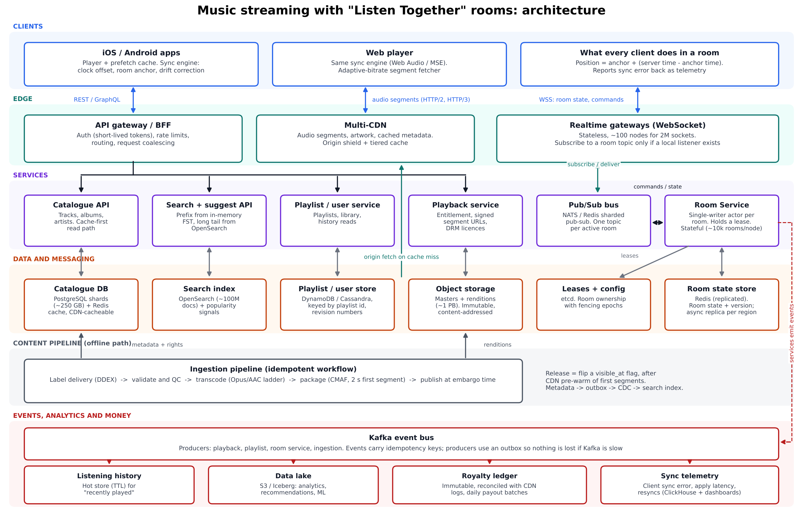
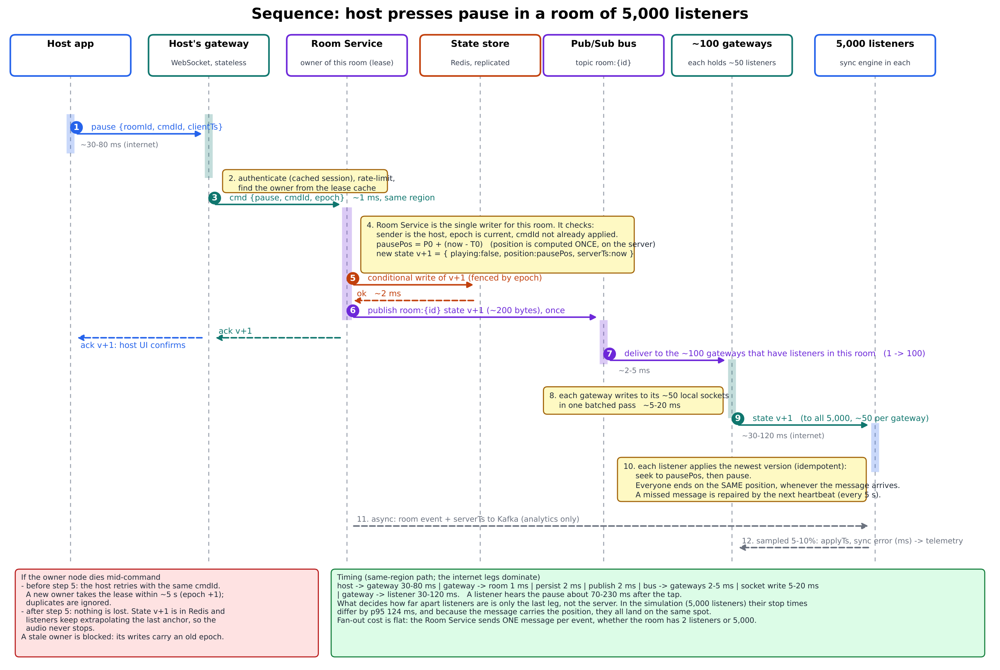

# Design doc: music streaming with "Listen Together" rooms

Backend and system architecture. Companion files: `architecture_diagram.pdf` (Figure A), `sequence_pause_5000.pdf` (Figure B), a working proof of concept of the room-sync design (`poc/`), and a sync simulation (`sim/q2_sync_poc.py`). Numbers marked *measured* come from the proof of concept (section 11); numbers marked * are assumptions.

## 1. Summary: the four decisions that shape everything

- **Audio never passes through our application servers.** It is stored as immutable, content-addressed segments and delivered by CDNs. Our servers only decide who may fetch what (signed URLs).
- **Rooms are synced by publishing a state anchor, not a stream of positions.** The anchor says "at server time T the track is at position P and is playing". Every client computes the current position from it, so a late, duplicated or reordered message cannot cause drift.
- **Each room has one single-writer owner**, chosen by a lease with a fencing epoch. There is no consensus on the hot path and no conflicts to merge.
- **Static stability.** If the room service, a gateway or a whole region fails, audio keeps playing: clients keep extrapolating the last anchor and keep fetching from the CDN. Only room controls (pause, skip, queue) degrade.

## 2. Assumptions and sizing

| Quantity | Value | How it was derived |
|---|---|---|
| Audio egress at peak | ~320 Gbps | 2M listeners × 160 kbps average (a mix of 64 to 320 kbps\*). With a 95% edge hit rate (popularity is very skewed), origin egress is ~16 Gbps. |
| Segment requests | ~250k req/s at the edge | 2 s first segment, then ~8 s segments\*: about one request per listener every 8 s. |
| Audio storage | ~1.2 PB renditions + ~1.3 PB masters | 50M tracks × 3.8 min average\*. Ladder: Opus 64/128/256 + AAC 128/256 = 832 kbps → ~24 MB per track. FLAC masters at ~900 kbps → ~26 MB per track. |
| Realtime gateways | ~80 needed, run ~105 | 2M sockets / 25k sockets per node\*, plus 30% headroom. *Measured* ~30–50 µs of CPU per socket write on a laptop, so 25k sockets with a 5 s heartbeat cost about 0.25 core. |
| Room Service | ~20 nodes | 200k rooms / ~10k rooms per node. Load at ~1 command per room per 30 s\* is ~330 commands/s per node. *Measured*: ~1,500 commands/s used 18% of one core. The limit is blast radius, not CPU. |
| Room fan-out | ~47k publishes/s | 6.7k commands/s plus 200k rooms re-publishing their anchor every 5 s. Each is delivered once per gateway that has a listener in the room. |
| Stream-end events | ~9.5k/s at peak | 2M listeners / ~210 s per track. These feed history, analytics and the royalty ledger. |
| Search | ~40k suggest requests/s\* | About 100k users typing at once × one request every ~2.5 s after debounce. ~90%\* are answered by the in-memory prefix tier. |

## 3. Audio delivery

- **Storage and encoding.** Lossless masters sit in object storage. An ingestion workflow produces the renditions as CMAF segments with HLS and DASH manifests: Opus for apps and modern browsers, AAC for Safari, cars and legacy devices. Object keys are content hashes, so a cached object is never stale and nothing ever needs invalidating.
- **CDN.** Two or more CDNs sit behind client-side failover. An origin shield and tiered caching mean a cold object is fetched from origin once per region, not once per edge. Concurrent requests for the same cold segment are coalesced.
- **Adaptive bitrate.** The client starts on a middle rung and estimates throughput from segment downloads and buffer level. It upgrades after two clean segments and downgrades at once on a stall.
- **Fast start (target: p95 time to first audio under 400 ms on a warm connection).**
  - The play response carries the manifest, saving a round trip.
  - The first segment is only 2 s long, so it is one small response.
  - The next track's first segments are prefetched ~30 s before the current track ends.
  - First segments of hot tracks and new releases are pre-warmed in every CDN.
  - HTTP/3 connections are kept alive.
- **Access control.** The playback service issues short-lived (5 to 10 minute) signed URLs bound to the user and the track. DRM licences can be added later without changing the delivery path.

## 4. Catalogue and search

- **Metadata.** PostgreSQL sharded by track id (~250 GB including rights data), with read replicas per region, Redis in front and CDN-cacheable GETs. Only ingestion writes, so the read path can cache very aggressively.
- **Search as you type has two tiers.**
  - *Prefix tier:* an in-memory FST of the top ~5M entities (tracks, artists, albums, playlists), ranked by popularity, rebuilt hourly and copied to every API node. It answers most keystrokes in under 10 ms with no network hop.
  - *OpenSearch* (~100M documents) handles the long tail, typo tolerance and multi-field ranking.
  - The client debounces at ~120 ms and cancels in-flight requests. Results are cached for 30 to 60 s by normalised prefix. Personalisation is blended on the client, so it costs the server nothing per user.
- **Publishing a release.** The ingestion workflow is made of idempotent, retried steps. It leaves a release "staged": renditions published, metadata written. Thirty minutes before the embargo, first segments are pre-warmed in all regions so release-day traffic does not stampede origin. At the embargo time a single `visible_at` flag flips, the catalogue version key changes, and CDC updates the search index within seconds.

## 5. Room sync (the hard part)

Figure B shows one full command. The design has six parts.

- **State, not commands.** `RoomState {epoch, version, trackId, playing, positionMs, serverTimeMs, queue, hostId}`. While playing, the current position is `positionMs + (serverNow − serverTimeMs)`. The owner turns every command into a new state with a higher version. Clients apply the highest `(epoch, version)` and ignore anything older. A pause carries the final position, computed once on the server, so every listener lands on exactly the same spot however late the message arrives.
- **Hard state and soft state are separate.** The anchor above is small, versioned, persisted and fenced. Presence and skip votes are *soft state*: gateways batch them every 250 ms, and the owner publishes them coalesced on the same topic, at most once a second (every 5 s in rooms over 100 listeners). A soft-state update never bumps the anchor version. Without this split, 5,000 people joining or voting would mean 5,000 new anchors, each sent to 5,000 listeners: 25M messages.
- **Clock sync.** The client measures the server clock with NTP-style pings (a burst of 8 on connect, then every 30 s) and keeps the sample with the smallest round trip. That bounds the error by half that round trip. Its blind spot is an *asymmetric* path: on a 300 ms link split 120/180 ms, the PoC client is off by a steady 32 ms (*measured*), and its own self-report cannot see it (section 8). The client also subtracts the device's output latency, which Bluetooth can push to 100–250 ms, using the audio stack's output timestamp.
- **Drift control.** Every 200 ms the client compares the position its speaker is producing with the anchor's position:
  - under 30 ms: do nothing;
  - 30 to 250 ms: change the playback rate by up to 2% until the error is gone (inaudible with time-stretching);
  - over 250 ms: hard seek.
  If playback stalls, the client pauses locally and jumps to the live position once it is buffered.
- **Every start is scheduled; pause is immediate.**
  - Play-after-pause starts at `serverNow + 250 ms`. Audio is already buffered, and the lead covers the p99 delivery spread.
  - Skip, seek and next track start at `serverNow + 400 ms`, so everyone has time to fetch the first segment from a warm CDN.
  - Everyone therefore starts on the same sample, rather than late receivers jumping in mid-phrase.
  - Pause applies on arrival, with the final position.
- **Late joiners.** The snapshot comes from a cache (the gateway's last state, else the state store), never from the room owner. The client computes the position it will need ~600 ms ahead, fetches the segment that contains it, and seeks to the exact offset. Target: p95 time to in-sync under 2 s; the PoC measured 287 ms.

**Fan-out.** The owner publishes one message per state change to topic `room:{id}`. A gateway subscribes only while it has a listener in that room. A room of 5,000 listeners therefore becomes about 100 gateways × 50 sockets each, and the owner does the same work for 2 listeners as for 5,000 (*measured*: the owner's process used 1% of a core while fanning out to 5,000). The owner re-publishes the anchor every 5 s as a heartbeat, which repairs any missed message. Slow sockets are protected: when a socket's send buffer backs up, soft-state messages to it are dropped; past 2 MB the socket is closed, and the client reconnects with a fresh snapshot. A skip happens when 50% of connected listeners vote for it, and the host can override.

**Failover.** Ownership is an etcd lease (TTL 5 s, renewed every 1.5 s) with a fencing epoch.
- State is written to Redis with a conditional write on `(epoch, version)`, so a stale owner cannot overwrite its successor.
- When the owner dies, a supervisor sees the expired lease and places the room on another node by rendezvous hashing. The new node loads the state and bumps the epoch.
- Gateways re-route and resend their member lists.
- Clients retry commands with an idempotent `cmdId`; recent ids are stored in the room state, so a retry is not applied twice even after a failover.
- Listeners never notice, because they keep extrapolating the last anchor.

## 6. Data and storage: what goes where and why

| Data | Store | Why |
|---|---|---|
| Audio files | Object storage + CDN | Large, immutable and read-heavy. Cheapest per GB, and the CDN does the serving. |
| Catalogue metadata | PostgreSQL shards + Redis + CDN | Relational (artist, album, track, rights), ~250 GB, written only by ingestion, read constantly. |
| Search | OpenSearch + in-memory FST | Ranking, fuzzy matching and prefix speed that SQL cannot give at 100M documents. |
| Playlists and library | DynamoDB / Cassandra (MVP: Postgres) | Keyed by playlist id, ordered items, optimistic `revision`. High availability and multi-region replication matter more than joins. |
| Room state and leases | Redis (state) + etcd (leases) | Tiny, hot and ephemeral, and conditional writes give fencing. Losing it resets room control, not audio; clients can report their last anchor to rebuild it. |
| Listening history | Kafka → wide-column hot store (TTL) + lake | Append-only and high volume. The hot store serves "recently played"; the lake (S3/Iceberg) feeds analytics and recommendations. |
| Royalty events | Kafka (idempotency keys) → immutable ledger → Postgres payouts | Money needs its own path: a play counts after 30 s, is cross-checked against CDN segment logs, never sampled or dropped, and reconciled daily. It is not shared with best-effort analytics. |

## 7. Reliability

- **Regional outage.**
  - Audio, catalogue and search are served active-active from the CDN and replicated data, and user data uses multi-region replication.
  - Rooms are homed in one region, with state replicated asynchronously (~2 s).
  - On failure, clients reconnect to the secondary region and the room is rebuilt from the replica, losing at most a few seconds of commands. Meanwhile audio continues from the CDN and cached manifests.
  - Expected effect: room controls unavailable for about a minute, no interruption to playback.
- **Deploys that don't drop live rooms.**
  - Gateways are stateless. They are drained 5% at a time: each tells its clients to reconnect after a jittered delay, carrying a resume token, and the rooms themselves are unaffected (*demonstrated* in the PoC).
  - Room Service nodes hand over leases gracefully. The old owner flushes its state and releases the lease, and the new one takes it within ~100 ms; gateways hold commands for that short window.
  - The protocol supports version N−1.
- **When parts are struggling.**
  - Shed load in this order: reactions and presence, then vote-count updates, then telemetry sampling, then non-essential room controls. Pause and skip are the last to go.
  - Gateways prioritise control messages over soft state.
  - Circuit breakers and bulkheads separate room control from search and catalogue.
  - Retries use jitter and a retry budget (at most 10% extra traffic), to avoid retry storms.
  - The client hedges to a second CDN after ~300 ms; search falls back to cached suggestions; joins to a hot room are rate-limited with a jittered retry.

## 8. Observability: the metrics that say whether sync works for users

- **Listener sync error** is the headline metric. Clients measure the position their output is producing against the anchor and sample 5–10% of reports. It is broken down by room size, region and device type. SLO: p95 under 150 ms, and 99% of listeners within 500 ms.
- **Ground truth, not just self-report.** A client measures its error against its *own* clock estimate, so it cannot see the error caused by an asymmetric path. In the PoC, a tab on a 300 ms asymmetric link reported 1 ms while its true error was 32 ms. So we also run:
  - synthetic canary listeners in every region, with NTP- or PTP-disciplined clocks, which join a canary room whose true state is known;
  - an opt-in "tap to compare" calibration, where two phones listen to each other's audio.
- **Command-to-apply latency:** from the server's publish time to the client's apply time, at p50/p95/p99 per command type. Alongside it: gateway fan-out time (one pass over local sockets) and bus lag.
- **Corrections:** hard seeks per listener-hour, rate-nudge frequency, rebuffer rate in rooms compared with solo listening, and late-joiner time to in-sync (p95 target under 2 s).
- **Clock quality:** the distribution of RTT and offset uncertainty, and the share of clients with RTT above 400 ms or no output-latency report.
- **Control plane:** lease takeovers, fenced (rejected) writes, time to recover, commands retried or lost, room-actor queue depth, event-loop lag, Redis and bus lag, and join success rate.

## 9. Key decisions and the alternatives I rejected

| Decision | Chosen | Rejected, and why |
|---|---|---|
| How rooms stay in sync | State anchor + client clock sync + drift control | (a) Periodic position ticks: more traffic, and the ticks themselves arrive late and jittery. (b) Applying commands on arrival: listeners' stop times spread by the delivery spread (simulated p99 207 ms). (c) Peer-to-peer (WebRTC): fails behind many NATs and is hard to authorise. (d) Server-mixed audio per room: costs servers and loses the CDN. |
| Realtime transport | WebSocket | SSE plus POST: workable, but two channels. WebTransport: not available everywhere yet. gRPC streaming: fine on mobile, weaker in browsers. |
| Fan-out | Pub/sub through gateways | The owner writing to 5,000 sockets itself: the owner becomes the bottleneck and pins connections. One Kafka topic per room: far too heavy for 200k topics. |
| Room state authority | Single-writer actor with lease and fencing | CRDTs or multiple writers: complexity we do not need, since one owner gives a total order. Row locks in a database: latency and contention. Trusting the lease alone without a fencing token: a paused owner wakes up and overwrites its successor. |
| Presence and votes | Soft state, coalesced, never in the anchor | Making them part of the versioned state: anchor churn that grows as N² with room size. |
| Audio packaging | Segmented CMAF with a 2 s first segment | Progressive files with range requests: very fast start, but adaptive bitrate is harder. Streaming audio through our servers: cost. |
| Search | FST prefix tier + OpenSearch | Postgres trigram: does not scale to 100M documents with ranking. Managed search (Algolia): good for the MVP, but the cost grows with 20M users. |
| Royalty events | A dedicated exactly-once ledger | Sharing the analytics stream: sampling and drops are acceptable for analytics but not for payouts. |

## 10. Failure scenarios and how the system handles each

| # | Scenario | What users see | How the system responds |
|---|---|---|---|
| 1 | Room Service node dies | Audio continues. Controls hang for up to ~5 s. | The lease expires (5 s) and the supervisor re-places the room. The new owner loads state from Redis with epoch +1, gateways re-route, and clients retry with the same `cmdId`. *Demonstrated* in the PoC (Crash button, and a test). |
| 2 | Owner stalls (GC pause, VM freeze) for longer than its lease, then wakes up still believing it owns the room | Nothing | A successor has taken over with a higher epoch. The stale owner's next write fails the conditional `(epoch, version)` check, and it drops the room. *Demonstrated* (Freeze button, and a test). |
| 3 | Gateway crashes or is deployed | A brief reconnect, no audio gap | Clients reconnect with jittered backoff and their session token. State comes from the room, not the gateway, and the room topic is re-subscribed. *Demonstrated* (Restart button). |
| 4 | Redis state shard fails | Controls pause for a few seconds | A replica is promoted. Gateways buffer commands for up to 3 s, then return a retryable error. If state is lost, the owner rebuilds it from what clients report (their last anchor and queue). |
| 5 | Whole region down | Audio continues; room controls down for about a minute | Health checks fail rooms over to the secondary region using the replicated state, losing seconds of commands. The CDN and cached manifests keep audio going. |
| 6 | CDN degraded, or a release-day cache stampede | Slower starts, possible rebuffering | The client hedges to a second CDN after ~300 ms. The origin shield and request coalescing protect origin, first segments were pre-warmed, and ABR steps down. |
| 7 | Host disconnects or is abusive | Music keeps playing; nobody can pause | After a 30 s grace period, the host role moves to the longest-connected listener and the room keeps playing the queue. Host commands are rate-limited. *Demonstrated* (test). |
| 8 | 5,000 people join one room within a few seconds | Joins may be delayed | Snapshots come from a cache, not the owner. Joins are rate-limited per room with a jittered retry, first segments are CDN-warm, and the fan-out cost is flat. *Measured*: 5,000 joined in 2.4 s with 266 deferred. |
| 9 | Slow network, large clock error, or Bluetooth latency | A "catching up" indicator; may skip ahead | Clock offset from the minimum-RTT sample, output-latency compensation, rate nudging and then seeking. A client that cannot keep up jumps to live rather than falling behind. Slow sockets lose soft state first. |
| 10 | Gateway cannot reach the Room Service (partition) | Controls rejected | Sockets stay open and clients keep playing from the last anchor. Commands fail fast with a retryable error, and service heals when the partition ends. |
| 11 | Kafka or the ledger is backlogged | Nothing | Producers use an outbox and idempotency keys, so events are delayed but never lost or double-counted. Payouts reconcile against CDN logs. |

## 11. Proof of concept: what was built and what it measured

`poc/` is a runnable implementation of section 5 (one command: `npm install && npm start`).
- **Architecture.** A core process runs 3 Room Service nodes, each with single-writer room actors, plus a lease store with TTL and fencing epochs (standing in for etcd), a state store with conditional writes (standing in for Redis), and a bus. Gateways run as separate OS processes sharing the port and reach the core over IPC.
- **Client.** A browser player that schedules audio on the Web Audio clock using the output timestamp, with clock sync, drift control, queue, vote-skip and a chaos panel.
- **Tests.** 21 automated tests cover fencing, idempotent retries, failover, vote-skip, host handover, and rate and size limits.

All measurements: one Windows laptop (Intel i5-13450HX, 16 threads), client and server on the same machine.

| What | Result |
|---|---|
| 5 real browser tabs (headless Chrome, real audio), one on a simulated 300 ms ± 80 ms asymmetric link. Scenario: play, seek, pause/resume, late join, owner crash, skip during failover, gateway restart. | True sync error p95 1.0–1.6 ms on clean links (late joiner p95 19.5 ms while converging); 32 ms on the bad link, which is the asymmetry error, still far inside 200 ms. 100% of samples within 200 ms. The late joiner was in sync in 287 ms. Zero hard seeks. Failover went from node 3 to node 1 (epoch 1 → 2) with no audio gap. |
| 1 room × 5,000 listeners, 4 gateway processes, 20 commands | 20/20 state changes reached all 5,000 listeners. Server-side delivery p50 23 ms, p99 78 ms, max 90 ms (other runs: p99 up to 160 ms). Room owner process: 1% of one core. |
| 1,000 rooms × 5 listeners, 10 commands each | 10,000/10,000 delivered; delivery p50 5 ms, p99 36 ms; the core used 18% of one core at ~1,500 commands/s. |
| Simulation, 5,000 listeners with realistic RTTs | With minimum-RTT clock sync: error p95 37 ms, p99 53 ms. With no clock sync: ~1 s. |

**Caveats.**
- Client and server compete for the same CPU: 8 gateway processes on this machine were *slower* than 4. Per-socket write cost (~30–50 µs including the kernel) should be re-measured on Linux gateway hosts.
- Same-machine browsers share one clock, so the internet leg is simulated rather than real.

## 12. What I would build first with a team of three, and what I would postpone

**Team:** one engineer on media, catalogue and search; one on realtime (rooms, gateways, state); one on the client player, the sync engine and telemetry.

| Weeks | Build now (single region, one CDN) |
|---|---|
| 1 to 3 | Ingestion and transcoding into a 3-rung ladder of CMAF segments; object storage; one CDN; the catalogue API (Postgres + cache); auth; a basic player with prefetch. |
| 4 to 6 | Search (managed OpenSearch plus a simple prefix cache); playlists in Postgres; play events to Kafka and S3; royalty events logged with idempotency keys (payout batch later). |
| 5 to 10 | **Listen Together v1**, starting from the PoC: Room Service (Redis state plus a lease and fencing), WebSocket gateways, anchor sync with clock offset and drift control, queue, skip votes, and sync-error telemetry from day one. |
| 10 to 12 | Load test with 5,000 bot listeners on separate machines; dashboards for the section 8 metrics; failure drills (kill the owner, freeze the owner, kill a gateway, kill Redis); launch to 5% of users. |

**Postpone:**
- multi-region active-active and multi-CDN switching (start with one CDN and a documented failover plan);
- lossless audio and DRM;
- personalisation and recommendations;
- collaborative-playlist conflict resolution;
- rooms above 5,000 listeners (they need a two-level fan-out);
- offline downloads and cost optimisation;
- advanced royalty fraud detection (log everything now, detect later);
- fully automated lease hand-over on deploy (accept a short reconnect at first).

**Biggest risks to retire early:**
- Bluetooth and device output latency: measure on real devices in week 6, because self-reported error cannot see it.
- CDN behaviour on release days.
- The cost of 250k segment requests per second.

